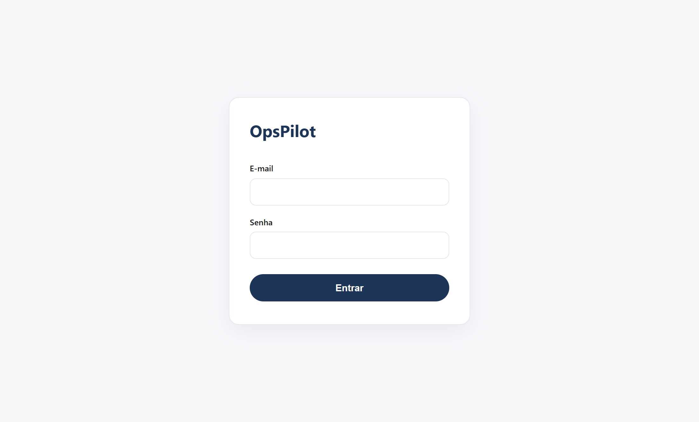
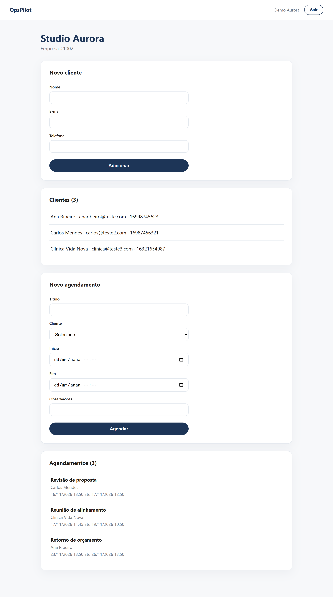
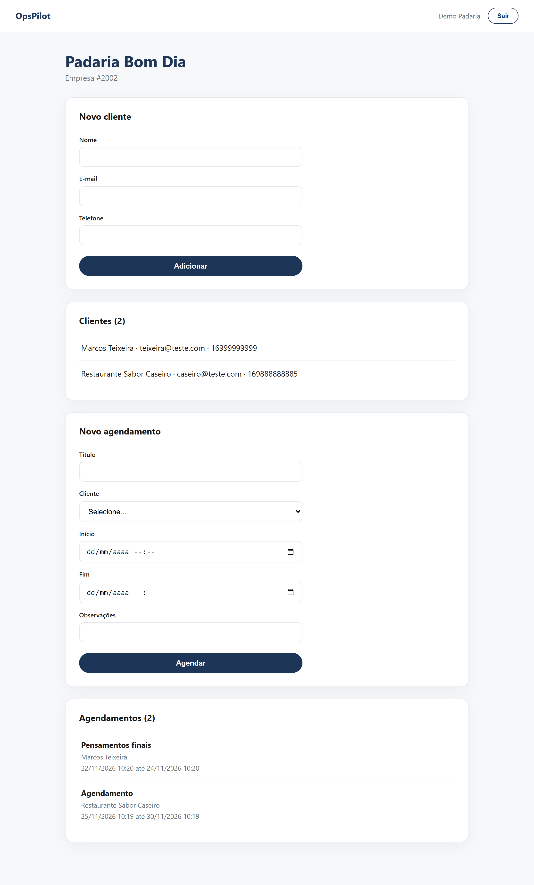
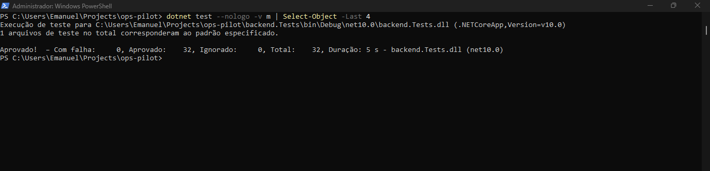

# OpsPilot AI


Aplicação web multiempresa (SaaS) para gestão de clientes e agendamentos, construída com **Angular 21**, **.NET 10** e **SQL Server**. Cada empresa só enxerga e altera os próprios dados, e essa regra é verificada por testes automatizados.

## Capturas de tela

| Login                                | Empresa A (Studio Aurora)                              | Empresa B (Padaria Bom Dia)                            |
| ------------------------------------ | ------------------------------------------------------ | ------------------------------------------------------ |
|  |  |  |

As duas empresas usam o mesmo banco e a mesma API, mas cada uma vê apenas o que é seu. Os dados das capturas são fictícios.

## O que já está implementado

**Backend (ASP.NET Core, .NET 10)**

- API REST em camadas (Controller, Service, DbContext) com DTOs separados por operação.
- Cadastro que cria a empresa e o primeiro usuário em uma única transação.
- Autenticação com JWT e senhas armazenadas com hash BCrypt.
- Persistência em SQL Server com Entity Framework Core e migrações.

**Segurança multiempresa**

- O `companyId` vem do token JWT, não do que o cliente envia.
- Ler, alterar ou excluir um recurso de outra empresa retorna `404`.
- Ao criar um cliente, vale a empresa autenticada mesmo que a requisição envie outro `companyId`.
- Não é possível criar um agendamento para um cliente de outra empresa.

**Frontend (Angular 21)**

- Login com formulário reativo, validações e tratamento de erros.
- `AuthGuard` protegendo as rotas e interceptor HTTP que anexa o token apenas às requisições para a própria API.
- Painel com cadastro e listagem de clientes e agendamentos.

**Qualidade**

- 32 testes automatizados (xUnit): unitários de serviços e autenticação, e de integração HTTP com testes de isolamento entre empresas.



## Arquitetura

```
Angular  ->  API .NET (JWT)  ->  Serviços  ->  EF Core  ->  SQL Server
```

## Como rodar localmente

Requisitos: .NET SDK 10, Node.js, Angular CLI e Docker Desktop.

1. Suba o SQL Server (a senha do usuário `sa` está em `docker-compose.yml`, somente para desenvolvimento local):

```bash
docker compose up -d
```

2. Configure os segredos do backend, aplique as migrações e rode a API:

```bash
cd backend
dotnet user-secrets init
dotnet user-secrets set "ConnectionStrings:DefaultConnection" "Server=localhost,1433;Database=OpsPilotDb;User Id=sa;Password=SUA_SENHA;TrustServerCertificate=true"
dotnet user-secrets set "Jwt:Key" "UMA_CHAVE_LONGA_COM_PELO_MENOS_32_CARACTERES"
dotnet ef database update
dotnet run
```

A API fica em `http://localhost:5265`.

3. Em outro terminal, rode o frontend:

```bash
cd frontend
npm install
ng serve
```

Abra `http://localhost:4200`. Ainda não há tela de cadastro, então crie a primeira empresa pela API:

```bash
curl -X POST http://localhost:5265/api/Auth/register \
  -H "Content-Type: application/json" \
  -d '{"companyName":"Minha Empresa","name":"Meu Nome","email":"eu@exemplo.com","password":"UmaSenhaForte123!"}'
```

4. Testes (pare a API antes, para não bloquear o `backend.exe`):

```bash
dotnet test
```

## Decisões técnicas

- **User Secrets** em vez de credenciais no código, para manter segredos fora do repositório.
- **Service Layer** separando a regra de negócio dos controllers, o que facilita os testes.
- **DTOs dedicados** por operação para controlar exatamente o que a API expõe e recebe.
- **Token anexado só à própria API** no interceptor, para não vazar credenciais a terceiros.

## Próximos passos

- [ ] Tela de cadastro de empresa no frontend
- [ ] Proteção do cadastro público contra abuso
- [ ] Edição e cancelamento de agendamentos
- [ ] Deploy público de demonstração
- [ ] Assistente de IA com acesso controlado aos dados de cada empresa

## Autor

Enmanuel Mancera · [LinkedIn](https://www.linkedin.com/in/enmanuelmancera) · [GitHub](https://github.com/manumancera88)
